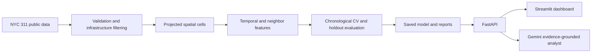

# GeoPulse AI
### Predict. Prioritize. Prevent.

GeoPulse AI is a geospatial machine-learning project that analyses urban infrastructure service requests, detects complaint hotspots, estimates 30-day recurrence risk by spatial cell, and explains model outputs using evidence-grounded Generative AI.

## Strict project scope

1. **ML pipelines:** public civic-data acquisition, validation, infrastructure category filtering, projected spatial aggregation, leakage-aware temporal and neighboring-cell features, model benchmarking, date-blocked cross-validation, Optuna tuning, and permutation importance.
2. **Backend APIs:** FastAPI endpoints for inference, spatial clustering, cell risk maps, evaluation reports, and optional Gemini-based analytical questions.
3. **Analytical dashboard:** Streamlit views for model metrics, feature importance, interactive risk maps, DBSCAN hotspot exploration, predictions, and evidence-grounded AI answers.

No marketing website, authentication, user accounts, subscriptions, payment systems, or unrelated CRUD application is included.

## Architecture



See [methodology](docs/methodology.md), [dataset notes](docs/datasets.md), [real-data results](docs/results.md), [API reference](docs/api.md), [GenAI design](docs/genai.md), and [deployment guide](docs/deployment.md).

## Local setup

Python 3.11 is recommended.

```bash
python -m venv .venv
# Windows PowerShell: .venv\\Scripts\\Activate.ps1
# macOS/Linux: source .venv/bin/activate
pip install -r requirements.txt
pip install -e .
```

Copy `.env.example` to `.env`. The NYC Open Data token is optional for small downloads. A Gemini API key is needed only for the AI analyst.

## Inspect, acquire, and train

Inspect a raw dataset to verify complaint category values:

```bash
python scripts/inspect_data.py data/raw/nyc311.csv
```

Acquire a bounded, month/time-slice-stratified NYC 311 sample and train:

```bash
python scripts/train.py --start 2025-01-01 --end 2025-07-01 --limit 30000 --cell-size-m 1000
```

To tune histogram gradient boosting with Optuna:

```bash
python scripts/train.py --input data/raw/nyc311.csv --cell-size-m 1000 --tune --trials 15
```

The default modelling cohort is restricted to configured infrastructure complaint types. Override with `--complaint-types` or `GEOPULSE_INFRA_TYPES` after inspecting source categories. Model selection uses mean temporal cross-validation PR-AUC; the final chronological holdout is reserved for reporting. Risk bands are relative quantiles of out-of-fold training probabilities, not fixed severity levels. The pipeline writes the cell/day panel, model, evaluation report, and permutation importance locally. Raw data and binary artifacts are excluded from Git.

## Run the API and dashboard

Terminal 1:

```bash
uvicorn backend.main:app --reload
```

Terminal 2:

```bash
streamlit run dashboard/app.py
```

FastAPI Swagger documentation is at `/docs`. Set `GEOPULSE_API_URL` if the API is not at `http://127.0.0.1:8000`.

## Tests

```bash
pytest
```

GitHub Actions installs dependencies, installs the package in editable mode, and runs the test suite on pull requests and pushes to `main` and `develop`. A separate workflow performs a bounded real-data training smoke run and uploads the model, panel, and evaluation artifacts.

## Interpretation and limitations

The initial data source and projection are NYC-specific. The model estimates complaint recurrence, not defect severity or engineering risk. Low/Medium/High bands are cohort-relative and not calibrated absolute probabilities. Chronological CV reduces temporal leakage but does not fully remove spatial dependence; spatially blocked evaluation and calibration are still needed before operational use. OSM enrichment is not implemented in this version. Performance metrics must come from a documented real-data run; synthetic test fixtures are not performance evidence.
