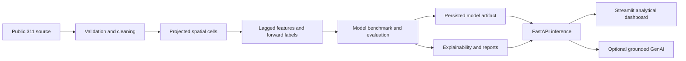

# Architecture

Training runs offline. The API loads the saved model; dashboard requests never retrain models. This is an analytical tool, not an infrastructure severity detector or engineering diagnosis.
